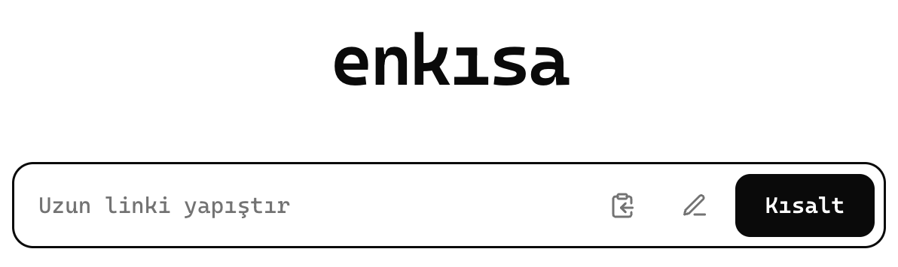
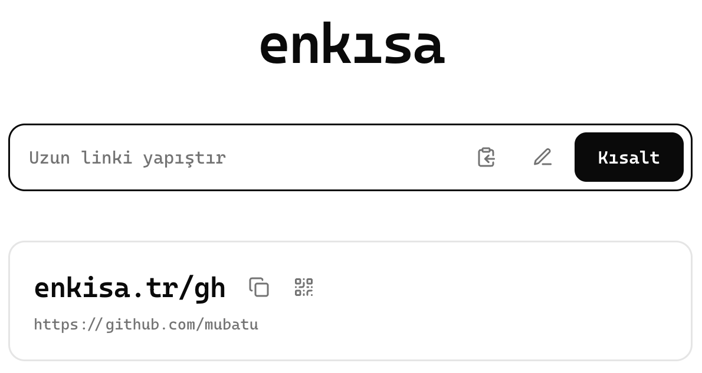
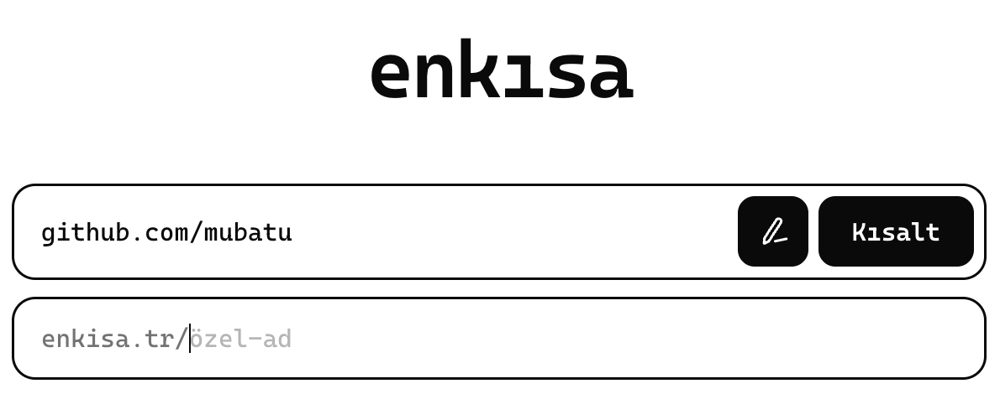

<strong>▶ Live: <a href="https://enkisa.tr">enkisa.tr</a></strong>

A minimal personal URL shortener that keeps links as short as they can be.

Codes are handed out in order and start at two characters, so the first links look like `enkisa.tr/aa`, `enkisa.tr/ab` and only grow to three characters after 1,296 of them. No account, no tracking scripts, just paste and shorten.

## Shorten

Paste a long link (or tap the clipboard icon) and press Kısalt. The short link is copied right away; the icons next to it copy it again or open its QR code.

## Custom aliases

The pencil icon opens a field for a name of your own, like `/cv` or `/menu`. Taken names are refused, and generated codes skip names that are already in use.

## Features

- Sequential codes from two characters: `aa`, `ab`, … `99`, then `aaa`; lowercase letters and digits only
- Anyone can shorten without an account, rate limited to 10 links per minute per IP
- The same URL gets the same code back instead of a new one
- Custom aliases up to 32 characters
- Password-protected admin at `/admin`: click counts, search, edit targets, delete
- 302 redirects, so a link can be retargeted later
- Deleted codes are never reused, so an old link can't quietly point somewhere new
- QR code for every link, rendered as SVG
- Paste from clipboard, light and dark favicon, phone layout

## Stack

- **Runtime:** Cloudflare Workers (JavaScript) serving the static pages and the API
- **Database:** Cloudflare D1 (SQLite)
- **Other:** Workers Rate Limiting, qrcode-generator, Cascadia Code
- **Deploy:** Workers Builds, deployed on every push to `main`
